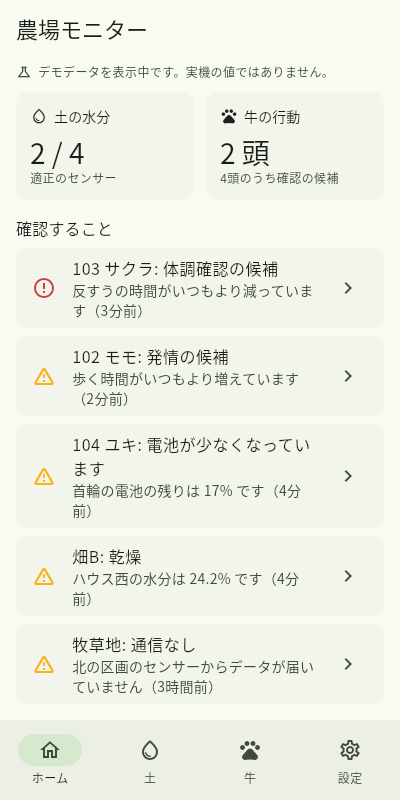
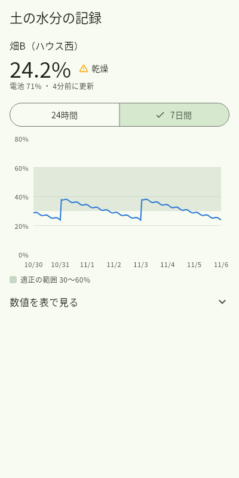
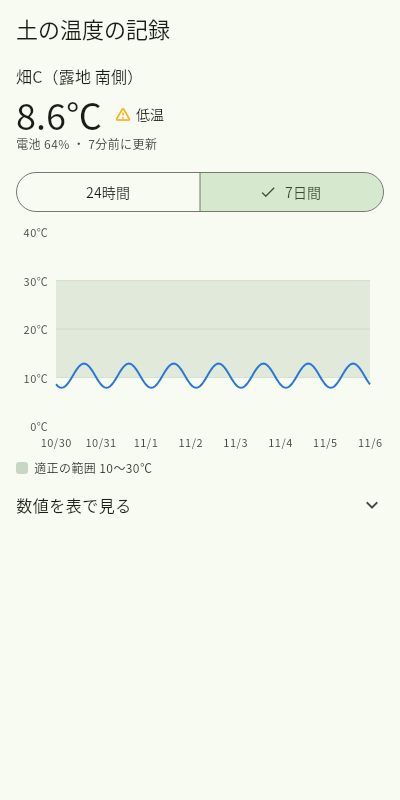
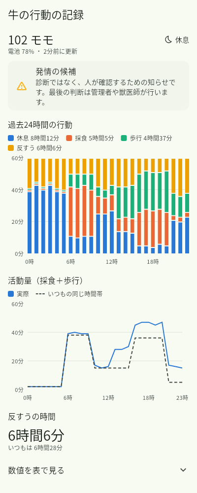

# デモアプリ

土の水分や牛の行動など、自作のセンサーの結果をスマホで確認する Android アプリ（Flutter）。

自作の開発物の結果をまとめて試すためのアプリです。使えそうなものは、ここから独立したアプリにしていきます。

**[APK をダウンロード](https://github.com/yusuke1090/demo-app/releases/latest/download/demo-app.apk)**

   

- **ホーム**: 全体の様子と、確認することの一覧
- **水分**: センサーごとの土の水分と、24時間・7日間の記録
- **温度**: センサーごとの土の温度と、24時間・7日間の記録
- **牛**: 今の行動、過去24時間の行動、いつもの活動量との比較、発情・体調の候補
- **設定**: デモデータと受信機の切り替え

発情や体調の候補は診断ではなく、人が確認するための知らせです。

今はデモデータで動きます。実機の受信機はまだなく、[デモ用のサーバー](receiver/demo_server.py)で接続を確かめられます。

## スマホに入れる

1. Android のスマホで上の「APK をダウンロード」を開く（リポジトリが非公開の間は、GitHub にログインしたブラウザで開く）
2. ダウンロードした `demo-app.apk` を開く
3. 「提供元不明のアプリ」の許可を求められたら、ブラウザに許可する

更新するときも、同じ手順で上書きできます。データはアプリを消さない限り残ります。

## しくみ

```text
ピコ（首輪・土のセンサー）── 電波 ──→ 受信機（ラズパイ）── Wi-Fi ──→ このアプリ
```

アプリは受信機の HTTP API を読むだけです。形は [docs/api.md](docs/api.md) にまとめてあります。
全体の考え方は、[Pico Studio のガイド 13章](https://github.com/yusuke1090/pico-studio/blob/main/guide/13-development.md)にあります。

## 受信機につないで試す

PC でデモ用のサーバーを動かします。Python だけで動きます。

```sh
python3 receiver/demo_server.py --port 8080
```

スマホを同じ Wi-Fi につないで、アプリの「設定」に PC の IP アドレスとポート（例 `192.168.3.123:8080`）を入れて「接続する」を押します。
つながらないときは、PC のファイアウォールで 8080 番が閉じていないか確かめます。

## 開発

`main` にプッシュすると、GitHub Actions が解析とテストをして、APK を作り直します。Android SDK や Mac は手元になくても開発できます。

手元で確かめるときは [Flutter](https://docs.flutter.dev/install) を入れて、次を実行します。

```sh
flutter pub get
flutter analyze
flutter test
```

| 場所 | 中身 |
| --- | --- |
| `lib/data/` | データの取得元。デモと受信機を `DataSource` で切り替える |
| `lib/screens/` | 画面 |
| `lib/widgets/` | グラフと共通の部品 |
| `receiver/` | 開発用の受信機 |

画面の画像は `SCREENSHOTS=1 flutter test --update-goldens test/screenshots_test.dart` で作り直せます（Noto Sans CJK が必要）。

### 署名の鍵

APK は、Actions の secret（`FARM_KEYSTORE_BASE64`、`FARM_KEYSTORE_PASSWORD`）の鍵で署名します。鍵が変わると上書き更新できなくなるので、作り直さないでください。
控えは手元の `~/.config/farm-monitor/` にあります（リポジトリには入れていません）。

### iPhone 版

同じコードから作れますが、`flutter create --platforms ios .` で設定を足して、Mac か macOS の CI でビルドし、Apple Developer Program（有料）で署名する必要があります。

## Google Play で公開するには

2026年11月時点の内容です。条件は変わることがあるので、始めるときに [Play Console ヘルプ](https://support.google.com/googleplay/android-developer/) で確かめます。Mac は不要で、今の GitHub Actions の仕組みも使い続けられます。

このデモアプリ自体は Play に出さず、APK で使います。公開するのは、ここから独立させたアプリが実データで動くようになってからにします。

### 手順

1. **開発者アカウントを作る**: Play Console に登録して、本人確認をする。登録料は1回だけ（25ドルのはず。登録画面で確認する）
2. **AAB でビルドする**: `flutter build appbundle` で作り、Play Console にアップロードする。Actions の設定に足す
3. **ストアの情報を用意する**: 説明文、アイコン、スクリーンショット、プライバシーポリシー、データの扱いの申告
4. **クローズドテストをする**: 12人以上が14日間続けて参加する（下の「テストの条件」）
5. **本番公開を申請する**: 質問に答えて審査を受ける

### テストの条件

[2023年11月13日より後に作った個人アカウント](https://support.google.com/googleplay/android-developer/answer/14151465?hl=en-GB)は、本番公開の前に、12人以上が14日間続けて参加するクローズドテストが必須。

- アプリごとに必要で、公開済みアプリの更新には不要とされている。独立アプリを増やすたびに、同じテストが必要になる
- 法人アカウントは対象外
- 自分や知人だけに配るなら、内部テストが手軽（12人の条件はなく、最大100人のはず。開発者アカウントは必要）

### 公開前に確かめること

| 項目 | 今の状況 | すること |
| --- | --- | --- |
| [対応 Android バージョン](https://developer.android.com/google/play/requirements/target-sdk) | API 36（条件を満たす） | Flutter を更新して、毎年の条件に合わせる |
| アプリ ID | `io.github.yusuke1090.farm_monitor` | 公開後は変えられないので、独立アプリでは名前に合う ID を決める |
| 中身 | デモデータだけ | 機能不足と判断されないように、実データで使える状態にする |
| 通信 | Wi-Fi 内の HTTP | 外部から使うなら HTTPS にする |

### APK の配布への影響

Google は [Play 以外で配るアプリにも開発者の確認を求める方針](https://support.google.com/android-developer-console/answer/16561738)を進めている。[全世界への展開は2027年以降の予定](https://www.androidauthority.com/android-sideloading-changes-timeline-3679204/)で、未確認の開発者のアプリも追加の手順や ADB で入れられるとされている。APK で配り続けるなら、日本での開始時期を確かめる。
